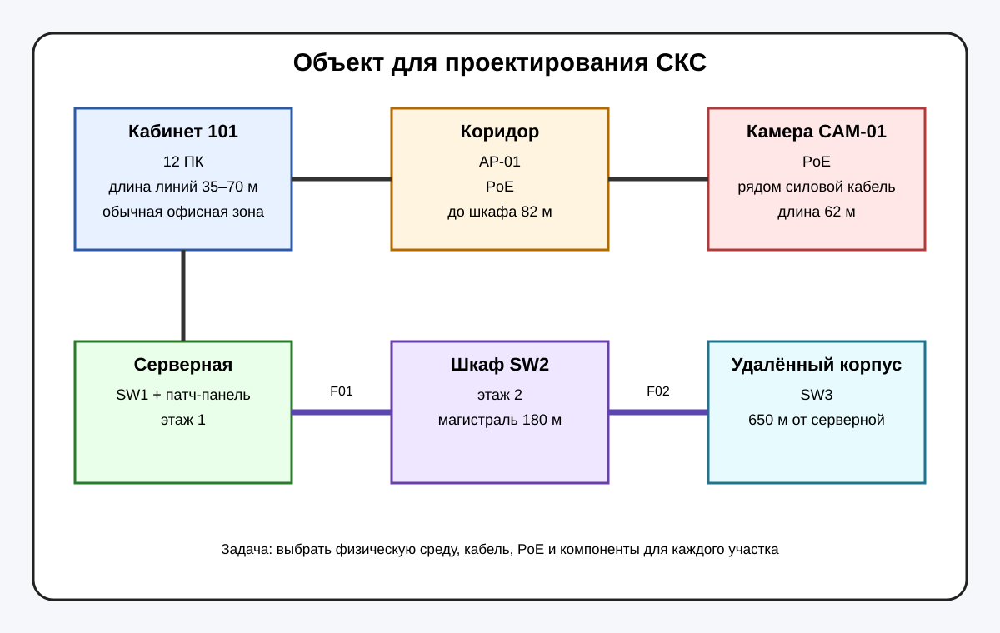
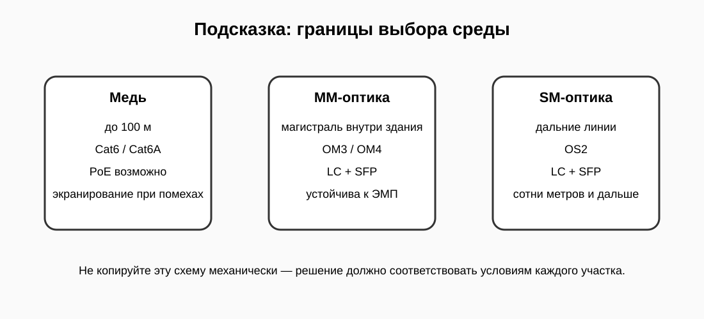

# ТФУ №5 · Проектирование физического сегмента сети

Теперь вы работаете не как диагност, а как проектировщик СКС.

Нужно спроектировать физический уровень сети для небольшого объекта: выбрать среду передачи, тип кабеля, оптику, PoE и основные компоненты.

## Условия

- Кабинет 101: 12 рабочих мест, линии 35–70 м.
- AP-01: точка доступа, PoE, расстояние до шкафа 82 м.
- CAM-01: IP-камера PoE, линия 62 м, рядом проходит силовой кабель.
- F01: магистраль между этажами, 180 м.
- F02: линия до удалённого корпуса, 650 м.

В этой работе нужно не угадывать, а обосновывать выбор физической среды.

На каждом этапе сначала изучите условия, затем заполните требуемый файл и нажмите **CHECK**.
