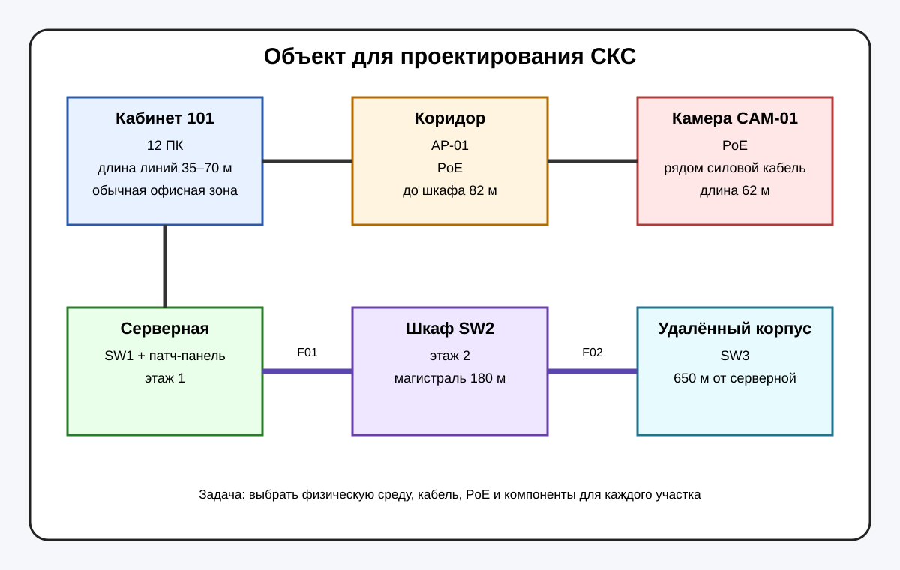

# 1. Изучить объект и классифицировать линии

Посмотрите ещё раз на схему объекта.



Также выведите таблицу условий:

```bash
object-info
```

Разделите линии на две группы:

- медные;
- оптические.

Создайте файл:

```bash
nano /root/tfu05/types.txt
```

Шаблон:

```text
COPPER=
FIBER=
```

Укажите номера линий через пробел.

После этого нажмите **CHECK**.
