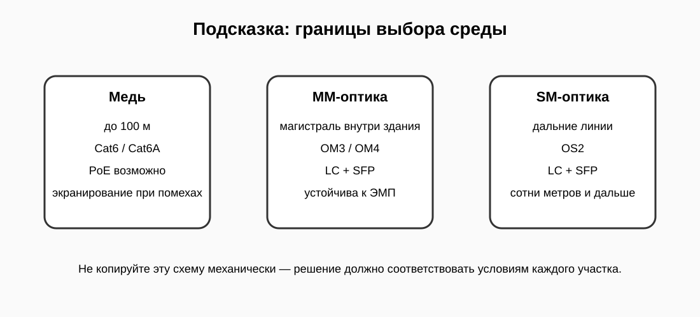

# 3. Выбрать оптические линии

Теперь выберите решения для F01 и F02.



Условия:

- F01 — 180 м, магистраль между этажами;
- F02 — 650 м, удалённый корпус.

Для этой работы используйте следующие варианты:

```text
OM3_LC_SFP
OS2_LC_SFP
```

Создайте:

```bash
nano /root/tfu05/fiber.txt
```

Шаблон:

```text
F01=
F02=
```

После заполнения нажмите **CHECK**.
