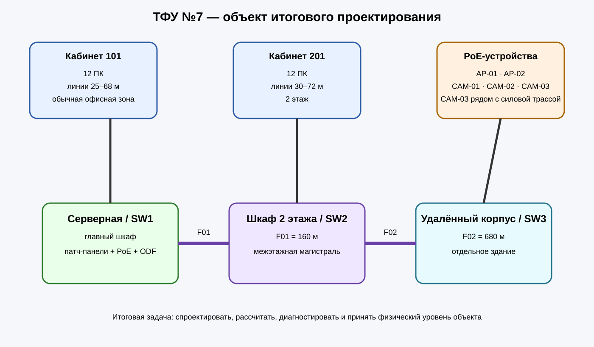

# 1. Изучить объект и составить план



Выведите условия объекта:

```bash
object-info
```

Создайте файл:

```bash
nano /root/tfu07/plan.txt
```

Шаблон:

```text
COPPER_SEGMENTS=
FIBER_SEGMENTS=
POE_DEVICES=
FAULT_TICKETS=
```

Заполните:

- медные пользовательские/PoE-сегменты;
- оптические магистрали;
- устройства, которым нужен PoE;
- три текущие аварийные заявки.

После этого нажмите **CHECK**.
