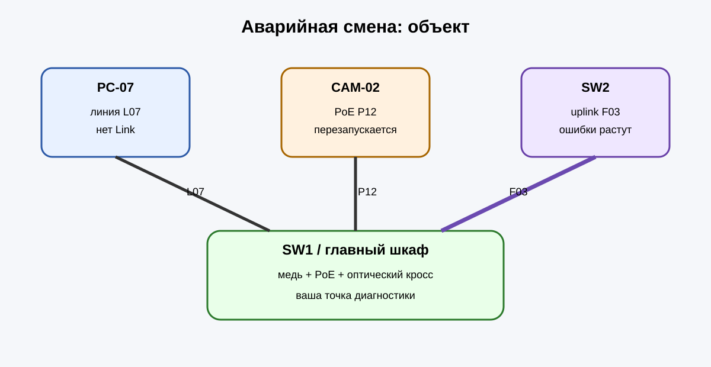

# ТФУ №6 · Аварийная смена

Сегодня вы не выполняете одну лабораторную операцию. Вы принимаете смену техника СКС и получаете **три аварийные заявки одновременно**.

## Заявки

1. **PC-07** — нет сетевого соединения. Линия `L07`.
2. **CAM-02** — PoE-камера включается и периодически перезапускается. Порт `P12`.
3. **SW2** — оптический uplink `F03` поднят, но счётчик ошибок быстро растёт.

Ваша задача — самостоятельно выбрать последовательность проверок, определить три разные причины, устранить их и оформить итоговый акт.

Доступные виртуальные приборы:

- `shift-status`
- `cable-test`
- `tdr`
- `poe-test`
- `load-test`
- `vfl`
- `power-meter`
- `otdr`
- `repair`

Не запускайте всё подряд без смысла: на каждом этапе думайте, **какой прибор отвечает на нужный вопрос**.
