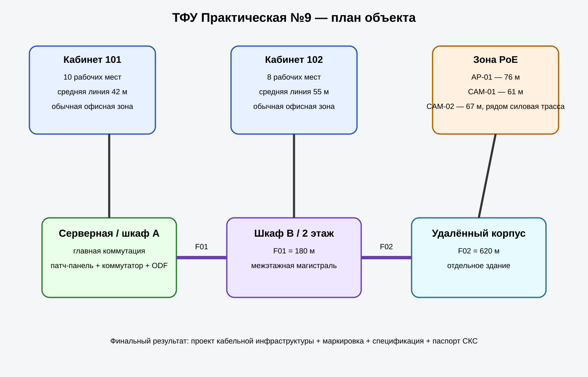

# 1. Изучить объект



Выведите исходные данные:

```bash
object-info
```

Создайте файл:

```bash
nano /root/tfu09/design.txt
```

Шаблон:

```text
ROOMS=
AP01=
CAM01=
CAM02=
F01=
F02=
```

Пока заполните только названия решений, которые считаете подходящими.

Допустимые обозначения:

```text
CAT6_UTP
CAT6_UTP_POE
CAT6A_FTP_POE
OM3_LC_MM_SFP
OS2_LC_SM_SFP
```

После заполнения нажмите **CHECK**.
