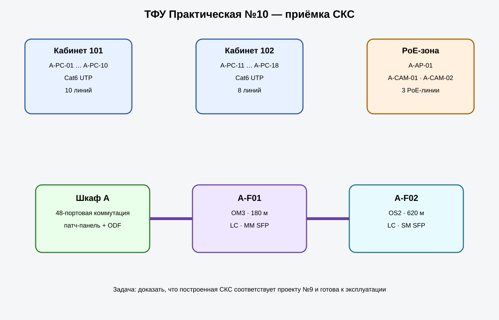

# 1. Сверить построенную СКС с проектом



Сначала получите сведения о фактически построенной системе:

```bash
inspect-project
```

Сверьте их с проектом практической №9.

Создайте:

```bash
nano /root/tfu10/project-check.txt
```

Шаблон:

```text
WORKPLACES=
COPPER=
POE_DEVICES=
PATCH_PANEL=
SWITCH_PORTS=
FIBER_BACKBONES=
LABELING=
DOCUMENTATION=
RESULT=
```

Для RESULT используйте `PASS` или `FAIL`.

После заполнения нажмите **CHECK**.
